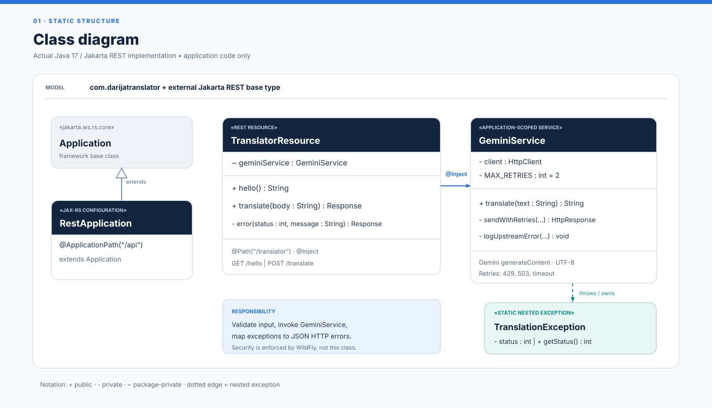
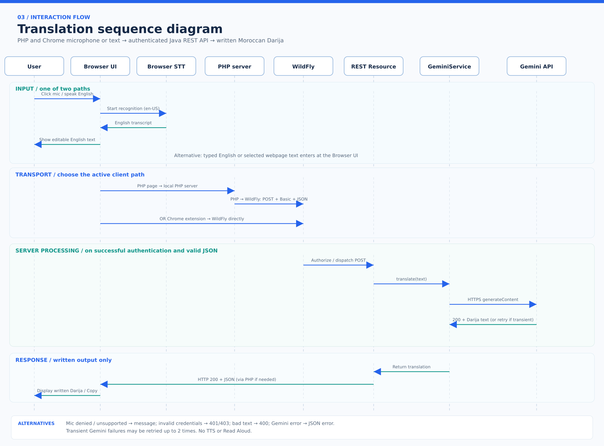
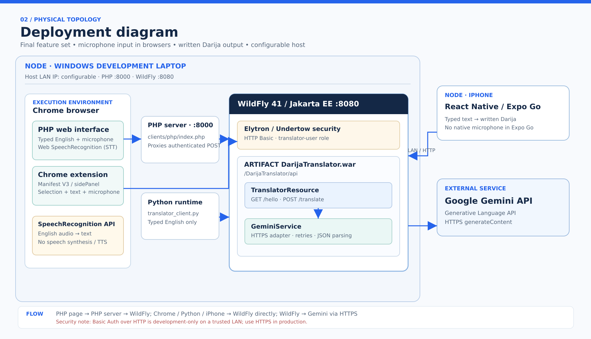

# DarijaTranslator

DarijaTranslator translates English text into written Moroccan Darija in Arabic script using Google Gemini. It explores how a shared REST service can make everyday Moroccan language more accessible to English speakers through web, command-line, browser-extension, and mobile interfaces.

The Java backend runs on WildFly and keeps the Gemini API key on the server. Four clients use the same authenticated JSON translation endpoint.

## Features

- English-to-Darija translation through Google Gemini.
- REST translation endpoint protected by WildFly Basic Authentication and the `translator-user` role.
- PHP web interface with server-side request forwarding.
- Python command-line client with an interactive password prompt.
- Chrome Manifest V3 extension: translate highlighted webpage text through a context menu and side panel, or type text directly.
- Browser-based English microphone recognition in PHP and Chrome, subject to browser support and permissions.
- React Native/Expo mobile interface with editable backend connection settings, RTL output, and copying.
- All four clients return written Darija only. No Read Aloud, speech synthesis, or automatic spoken output is included. PHP/Chrome Stop controls cancel microphone recognition.
- Request validation, upstream error handling, and translation response checks. Gemini responses must include a completed, non-empty translation.

## Technology stack

| Technology | Purpose |
| --- | --- |
| Java 17 / Maven | Backend `release 17` compilation and WAR build |
| Jakarta EE Web API 10 / Jakarta REST | REST resources, CDI injection, JSON processing |
| WildFly 41 / Elytron | Application hosting and container-managed Basic Authentication |
| Google Gemini REST API | Translation through `generateContent` |
| PHP | Web UI and server-side HTTP proxy |
| Python 3 standard library | Interactive CLI and authenticated HTTP requests |
| JavaScript / Chrome Manifest V3 | Selection context menu, service worker, side panel, browser speech recognition |
| Expo `~58.0.25` / React Native `0.88.1` / React `19.3.0` | Mobile client |
| TypeScript / ESLint | Mobile static checks |
| JUnit Jupiter / Mockito | Backend resource unit tests |
| Node.js built-in assertions and VM | Extension and shared browser speech tests |

Versions above come from project configuration, except WildFly 41, the intended deployment environment. No server installation is bundled.

## Architecture

```text
Client → WildFly / Jakarta REST → Gemini API → Written Darija response
```

`RestApplication` mounts `/api`; `TranslatorResource` mounts `/translator`. WildFly authenticates translation requests before the resource validates JSON. `GeminiService` calls Google's HTTPS API with server-side credentials and requests Arabic-script Darija. The resource returns a JSON translation or an error.

The PHP browser submits a form to PHP; PHP forwards JSON and Basic credentials to WildFly. This avoids a browser-to-WildFly cross-origin request, but PHP must be able to reach the backend. The Chrome side panel calls WildFly directly using extension host permissions. Python and the native mobile app also call the backend directly. No general browser CORS configuration is supplied; the Expo web script is not a verified fifth client.

Existing UML assets are preserved in `docs/UML/`. Their PlantUML sources are available beside the rendered diagrams; deployment details should be checked against the configuration described here.

**UML rendering status:** sequence/deployment PlantUML notes describe English speech-to-text input and written Darija output only. No PlantUML renderer was found, so PNG/SVG files were not regenerated during this cleanup. The existing renders already describe the same STT-only scope but precede the latest source-note wording; regenerate them with PlantUML when available. The Java class diagram is unchanged.

### Class diagram



### Sequence diagram



### Deployment diagram



## Project structure

```text
DarijaTranslator/
├── README.md
├── .gitignore
├── pom.xml
├── src/
│   ├── main/
│   │   ├── java/com/darijatranslator/
│   │   │   ├── RestApplication.java
│   │   │   ├── TranslatorResource.java
│   │   │   ├── GeminiService.java
│   │   │   └── Main.java
│   │   └── webapp/WEB-INF/
│   │       ├── web.xml
│   │       └── jboss-web.xml
│   └── test/
│       ├── README.md
│       └── java/com/darijatranslator/TranslatorResourceTest.java
├── clients/
│   ├── php/                 # index.php, speech.js, README.md
│   ├── python/              # translator_client.py, tests/test_translator_client.py
│   └── mobile/
│       ├── App.tsx
│       ├── index.ts
│       ├── app.json
│       ├── package.json
│       ├── package-lock.json
│       ├── tsconfig.json
│       ├── eslint.config.js
│       ├── assets/          # App icons and splash assets
│       ├── AGENTS.md
│       ├── LICENSE
│       └── README.md
├── chrome-extension/
│   ├── manifest.json
│   ├── service-worker.js
│   ├── sidepanel.html
│   ├── sidepanel.css
│   ├── sidepanel.js
│   ├── speech.js
│   ├── README.md
│   └── tests/              # verify.cjs, speech.cjs
└── docs/UML/               # class, sequence, deployment: .puml, .svg, .png
```

Generated output, dependencies, caches, and IDE files are omitted. `Main.java` is a starter console program, not the REST server entry point. Maven Wrapper launchers are absent; use an installed Maven.

## Prerequisites

| Tool | Requirement |
| --- | --- |
| JDK | Java 17 release target; use a JDK supported by your WildFly 41 installation; audit builds/tests passed on JDK 17.0.18 and 25.0.2 |
| Maven | Installed Maven with WAR support; no Maven minimum or wrapper version is pinned; IntelliJ's bundled Maven 3.9.16 was used offline for this audit |
| WildFly | WildFly 41, with the standard `ApplicationRealm` / `ApplicationDomain` security mapping |
| Gemini access | API key, an available model, network access, and sufficient quota |
| PHP | PHP supporting typed functions (7+ syntax); PHP 8.4 passed syntax checking; enable `allow_url_fopen` for HTTP stream requests |
| Python | Python 3 supporting f-strings (3.6+ client syntax); no third-party packages; audit checks used Python 3.14.4 via `py` |
| Chrome | Version 116+ with side-panel support |
| Node.js / npm | Mobile React Native package requires Node `^22.13.0`, `^24.3.0`, or `>=26.0.0`; checks used Node 24.19.0 |
| Expo Go | A version compatible with this project's SDK 58, installed on the phone |

Backend deployment, a live Gemini model, and device connectivity must be verified on your own machine. PHP/Python syntax floors are not recommendations to install obsolete runtimes.

## Backend setup

Commands below use PowerShell from the repository root unless stated otherwise. Replace all angle-bracket placeholders. On Unix, use the corresponding WildFly `.sh` scripts and shell environment syntax.

### 1. Configure Gemini and WildFly paths

```powershell
$env:JAVA_HOME = '<JDK_HOME>'
$env:WILDFLY_HOME = '<WILDFLY_HOME>'
$env:GEMINI_API_KEY = '<YOUR_GEMINI_API_KEY>'
$env:GEMINI_MODEL = '<AVAILABLE_GEMINI_MODEL_ID>'
```

Use a model ID available to your Google project, without a `models/` prefix. The service accepts letters, digits, dots, underscores, and hyphens. Its source fallback is `gemini-3.8-flash`; availability of that fallback has not been verified. Set `GEMINI_MODEL` explicitly. The application reads process environment variables, not `.env` files. Start or restart WildFly from the configured shell so it inherits them. For a system service, configure its environment separately. Avoid putting secrets in shell history or shared scripts; use your environment's secret injection mechanism where available.

### 2. Create an application user

```powershell
& "$env:WILDFLY_HOME\bin\add-user.bat"
```

Choose **Application User**, retain `ApplicationRealm`, enter a placeholder-style account such as `<APP_USER>` with your own password, and assign the group `translator-user`. This must be an application account, not a management account. Enter passwords interactively. The application's `jboss-web.xml` selects `other`, which relies on the standard Undertow/Elytron mapping to `ApplicationDomain` and `ApplicationRealm`. A customized WildFly configuration may need its administrator to restore or adapt that mapping.

### 3. Build and deploy

```powershell
mvn clean package
Copy-Item -LiteralPath '.\target\DarijaTranslator.war' -Destination "$env:WILDFLY_HOME\standalone\deployments\DarijaTranslator.war"
& "$env:WILDFLY_HOME\bin\standalone.bat"
```

The Maven final name is `DarijaTranslator`, so the expected artifact is `target/DarijaTranslator.war`. Confirm a successful deployment in the WildFly console and the deployment scanner's `.deployed` marker. The API base URL is `http://localhost:8080/DarijaTranslator/api/translator`. The deployment scanner must be enabled for this copy-based workflow.

For phone/LAN testing, start WildFly with `-b 0.0.0.0` appended to the `standalone.bat` command. This exposes the application interface to the network; restrict firewall access to your trusted private network. Do not expose the management interface. Use `ipconfig` on Windows to find the active Wi-Fi/Ethernet IPv4 address and substitute `<YOUR_LAN_IP>` in client settings.

### 4. Test the endpoints

Use the cURL examples below. On Windows PowerShell, use `curl.exe` to avoid the `curl` alias; on other shells use `curl`. Each command is on one line. The authenticated example prompts for the password, keeping it out of the command.

## Client setup

Client addresses are currently source constants except for the mobile connection field. Configure them before use; they are not environment-variable options.

### PHP web client

1. Set `$url` in [index.php](clients/php/index.php) to the full endpoint, for example `http://localhost:8080/DarijaTranslator/api/translator/translate` when PHP and WildFly run on the same computer, or `http://<YOUR_LAN_IP>:8080/DarijaTranslator/api/translator/translate` otherwise.
2. Start from the repository root:

   ```powershell
   php -S localhost:8000 -t clients/php
   ```

3. Open `http://localhost:8000`, enter the WildFly application credentials and English text, and translate. For microphone recognition, allow browser microphone access and use a supporting browser on localhost or HTTPS. The PHP development server is for local testing.

### Python command-line client

Set `URL` in [translator_client.py](clients/python/translator_client.py) to the full translation endpoint; its default is localhost. Then run:

```powershell
python clients/python/translator_client.py
```

Enter English text, application username, and password at the prompts. Python uses only the standard library; no `pip install` step is needed.

On Windows, use `py` in place of `python` if the latter resolves to a Microsoft Store alias. Empty credentials and usernames containing a colon are rejected. Malformed JSON, invalid translation values, HTTP failures, and connection/timeout errors produce console messages.

### Chrome extension

1. Set `ENDPOINT` in [sidepanel.js](chrome-extension/sidepanel.js) to the full endpoint.
2. Ensure `host_permissions` in [manifest.json](chrome-extension/manifest.json) includes the matching scheme and host, such as `http://localhost/*` or `http://<YOUR_LAN_IP>/*`. Chrome host patterns do not restrict ports. The current manifest allows localhost and a fixed LAN host; update the LAN entry when changing networks.
3. Open `chrome://extensions`, enable **Developer mode**, choose **Load unpacked**, and select `chrome-extension/`. Reload the extension after configuration edits.
4. Highlight English on a normal webpage and choose **Translate to Darija** from its context menu. Enter credentials in the side panel. The toolbar action also opens the panel for typed input. With credentials present, new selections trigger translation. Test **Copy translation** and microphone recognition where supported.

This client calls WildFly directly; it does not use the PHP proxy or contain a Gemini key.

### React Native / Expo mobile client

```powershell
cd clients/mobile
npm ci
npm run ios
```

`npm run ios` runs `expo start --go --lan`; it starts the physical-device Expo Go workflow, not an iOS simulator. `npm start` also starts the Expo development server. The lockfile is included; use `npm ci` for its dependency versions.

Connect the phone and development computer to the same trusted network, open the displayed QR code in compatible Expo Go, and allow Local Network access. In the app, replace the prefilled address with `http://<YOUR_LAN_IP>:8080` (base URL only). The app appends `/DarijaTranslator/api/translator/translate`. Enter the application username/password and translate. Do not use localhost on a physical phone; this client rejects loopback and emulator aliases.

Allow WildFly and Metro's displayed port through the private-network firewall as needed. iOS transport policy may block HTTP; use an HTTPS endpoint with a certificate trusted by the phone if necessary. An Expo development-server tunnel does not tunnel the REST API. Native microphone recognition is not implemented in the iPhone app; keyboard dictation may populate the text field.

## REST API

Paths below are relative to `http://localhost:8080/DarijaTranslator`.

| Method | Path | Authentication | Response |
| --- | --- | --- | --- |
| GET | `/api/translator/hello` | Public | `200 text/plain`: `Hello from Darija Translator!` |
| POST | `/api/translator/translate` | Basic; `translator-user` role | `200 application/json` with `translation` |

Translation request (`Content-Type: application/json`):

```json
{"text":"Hello"}
```

Response shape (illustrative text; Gemini output varies):

```json
{"translation":"سلام"}
```

The input must be a JSON object containing a non-empty string `text`. The backend does not enforce English detection or a maximum text length; the PHP UI separately limits input to 5,000 characters. Service errors return `{"error":"<message>"}`.

| Status | Condition |
| --- | --- |
| 400 | Empty body: `A JSON body with non-empty text is required.`; missing/non-string/blank text: `text must be a non-empty string.`; malformed/non-object JSON: `Invalid JSON object.` |
| 401 | WildFly rejects missing or invalid credentials |
| 403 | Authenticated account lacks `translator-user` |
| 502 | Upstream non-success HTTP, connection failure, absent/incomplete translation, or malformed Gemini response |
| 503 | Missing API key, invalid model ID syntax, or interrupted request |
| 504 | Gemini request timeout after retries |

WildFly controls authentication error bodies; they are not guaranteed to be JSON. Jakarta REST may also return framework errors such as 405 for unsupported methods or 415 for unsupported media types. An unavailable model with a syntactically valid ID is an upstream failure (502), not a model-syntax error (503).

```powershell
curl.exe -i http://localhost:8080/DarijaTranslator/api/translator/hello
curl.exe -i --user '<APP_USER>' -H 'Content-Type: application/json' --data-binary '{"text":"Hello"}' http://localhost:8080/DarijaTranslator/api/translator/translate
curl.exe -i -H 'Content-Type: application/json' --data-binary '{}' http://localhost:8080/DarijaTranslator/api/translator/translate
curl.exe -i --user '<APP_USER>' -H 'Content-Type: application/json' --data-binary '{}' http://localhost:8080/DarijaTranslator/api/translator/translate
```

The last two calls check unauthenticated rejection (401) and authenticated validation (400) without invoking Gemini. For older Windows PowerShell/native argument handling that strips JSON quotes, write the request to a file instead:

```powershell
Set-Content -LiteralPath "$env:TEMP\darija-request.json" -Value '{"text":"Hello"}' -Encoding Ascii
curl.exe -i --user '<APP_USER>' -H 'Content-Type: application/json' --data-binary "@$env:TEMP\darija-request.json" http://localhost:8080/DarijaTranslator/api/translator/translate
```

## Testing

### Existing automated checks

From the repository root:

```powershell
mvn clean test
mvn package
node chrome-extension/tests/verify.cjs
node chrome-extension/tests/speech.cjs
php -l clients/php/index.php
node --check clients/php/speech.js
py -m py_compile clients/python/translator_client.py
py -m unittest discover -s clients/python/tests -v
```

From `clients/mobile/`:

```powershell
npm run typecheck
npm run lint
node node_modules/eslint/bin/eslint.js App.tsx index.ts eslint.config.js
```

[Backend test notes](src/test/README.md) describe the JUnit/Mockito resource tests. They mock `GeminiService`, check request validation, Unicode/escaping, response shape, and propagated service errors. They do not test Gemini internals, HTTP transport, CDI deployment, or WildFly authentication. Maven writes reports under `target/surefire-reports/`.

Extension tests use mocked Chrome/HTTP APIs. The shared speech test also checks that PHP and Chrome use identical speech helper files. Python tests mock input, password entry, and HTTP to cover authentication, Unicode, invalid responses, and connection errors. No mobile device integration suite is present. The direct ESLint command is a fallback if the Expo lint wrapper stalls.

Verified outcomes from the final source audit:

| Check | Outcome |
| --- | --- |
| Maven `-o clean test` | PASS: 24 executed, 24 passed, 0 failed, 0 errors, 0 skipped |
| Maven `-o package` | PASS: the same 24 tests passed again; `target/DarijaTranslator.war` built |
| Chrome `verify.cjs` | PASS: manifest/host restrictions, selection transfer, Basic auth, response/error handling, stale responses; one assertion-based suite, no individual test count emitted |
| Shared `speech.cjs` | PASS: recognition, transcription, cancellation, denied permissions, unsupported recognition; one assertion-based suite |
| PHP and browser JavaScript syntax | PASS: `php -l` plus `node --check` on PHP speech and Chrome scripts |
| Python compile / unittest | PASS: 6 test methods, 0 failures/errors/skips; multiple invalid cases covered by subtests |
| Mobile `npm run typecheck` | PASS |
| Mobile `npm run lint` | NOT VERIFIED: Expo wrapper stalled and was interrupted |
| Direct local ESLint | PASS for `App.tsx`, `index.ts`, and `eslint.config.js` |
| Expo offline dependency check | Reports up to date, but warns offline validation is unreliable; local checks confirm all 12 direct dependency versions match manifest/lockfile and Expo bundled ranges where specified |
| WildFly/Elytron, live Gemini, real browsers and phone | NOT VERIFIED; no live Gemini requests made |

Maven was not on PATH and no wrapper launchers exist; IntelliJ-bundled Maven 3.9.16 was invoked by absolute path, using cached dependencies with `-o`. The normal setup commands remain `mvn clean test` and `mvn package` after adding Maven to PATH. Both commands passed on JDK 25.0.2 and were then rerun successfully on JDK 17.0.18 with Java 17 release compilation. JDK 25 runs emitted Mockito self-attachment/dynamic-agent and JVM class-sharing warnings; JDK 17 emitted only the JVM class-sharing warning. These did not fail tests.

### Manual acceptance checks

| Client / layer | Procedure |
| --- | --- |
| Backend security | POST `{}` without credentials and with invalid credentials: expect 401. Use a valid account without the role: expect 403. With the role: expect JSON 400, without a Gemini call. |
| PHP | Translate typed English; verify Arabic output, empty-input validation, wrong-account errors, and unreachable-backend feedback. Allow then deny microphone access and confirm typed translation remains usable. |
| Python | Translate English with valid credentials; test empty input, wrong password, stopped WildFly, and readable Unicode output. |
| Chrome | Select text, open the context-menu side panel, authenticate, translate, copy, and select new text. Test toolbar opening, changed account, missing role, network failure, microphone denial, and extension reload. |
| Mobile | Open in Expo Go on a physical phone; enter the LAN base URL and credentials, translate, and copy Arabic output. Test blank fields, wrong credentials, missing role, network failure, Clear during a pending request, and reopening with empty credentials. |

Use controlled mock endpoints for malformed responses or timeout conditions where needed. Do not expose Authorization headers in screenshots or logs.

For PHP and Chrome, test Stop during microphone recognition and confirm that typed, selected, and microphone-triggered translations produce written output without audio. Mobile accepts text input only. Chrome currently has no dedicated Clear button; editing the English input clears its result and cancels a pending request. PHP Clear empties English input/password and stops recognition; it retains the previously rendered result and username. PHP uses a synchronous form submission without a dedicated loading indicator. Mobile Clear cancels requests and clears input, result, password, and notices.

## Security considerations

- WildFly protects POST `/api/translator/translate` using Basic Authentication and `translator-user`; `/hello` is public. The standard realm/domain mapping is required.
- Gemini credentials are read from the server environment and sent to Google in `x-goog-api-key`. No client needs that key. Environment variables are not encrypted storage; protect server access and inject secrets securely.
- Basic Authentication encodes credentials with Base64; it does not encrypt them. Use HTTP only on a trusted local development network. Outside that environment, require HTTPS for both browser-to-PHP and client/proxy-to-WildFly traffic. The supplied descriptors do not enforce HTTPS.
- PHP uses the password for its server-side request without rendering it back. Chrome and mobile keep credentials in memory. Chrome session storage contains selected text; selection and translation content may be sensitive.
- English text is sent to Google. Browser speech recognition may also send audio to the browser vendor. Consider data privacy before entering personal or confidential material.
- There is no application rate limiting, backend input-length cap, or custom account-management interface. Model quota and translation accuracy remain external constraints. Response checks validate completion/shape, not linguistic correctness.
- `.gitignore` excludes local secrets, private-key/credential-store formats, dependencies, caches, logs, build output, and IDE files while keeping the mobile lockfile, UML assets, wrapper configuration, and environment examples eligible for tracking. No IDE files, dependencies, caches, or build output are currently in the index. No commits exist yet, so there is no committed history to inspect or rewrite.
- A read-only working-tree and index review found no obvious real Gemini keys, literal Basic credentials, private keys, or tokens. Passwords in regression fixtures are deliberately fake. No `.env`, private-key files, or sensitive log files were found outside excluded dependency/Git internals. This review is a pattern-based check, not a guarantee against every possible secret format. No credential rotation is indicated by the findings.


## Known limitations and future improvements

- Browser recognition depends on platform support, microphone permission, and network availability; Chrome side panels may deny recognition.
- Native microphone recognition is not yet implemented in the iPhone application.
- Translation needs access to Google's Gemini API, a valid available model, and quota; results can vary and need human review.
- Network changes can require updating PHP/Python/extension endpoint constants, extension host permissions, and the mobile connection field. Centralized configurable addresses would simplify setup.
- The mobile timeout is 30 seconds; backend retries may outlast it. Gemini requests have a 60-second timeout per attempt and up to two retries for timeouts, HTTP 429, or HTTP 503. PHP/Python/Chrome also use their own timeouts.
- Future work could add deployed HTTP/security integration tests, Gemini response-parser tests, consistent client configuration, rate limits, and verified HTTPS deployment instructions.
- PlantUML speech notes match the final STT-only scope; PNG/SVG regeneration is pending because a renderer is unavailable. The Chrome localhost-only test mismatch is resolved; its required-host checks accept the configured backend and reject unrelated/broad host permissions.
- `Main.java` is unused starter code and is retained rather than deleting source during the audit. Gemini response parsing/retries have no dedicated unit suite; resource tests mock the entire service.

## Academic context

DarijaTranslator is a university RESTful web services assignment demonstrating a secured Java REST API, an external AI service integration, and multiple client applications. UML source and rendered diagrams accompany the implementation in `docs/UML/`.
